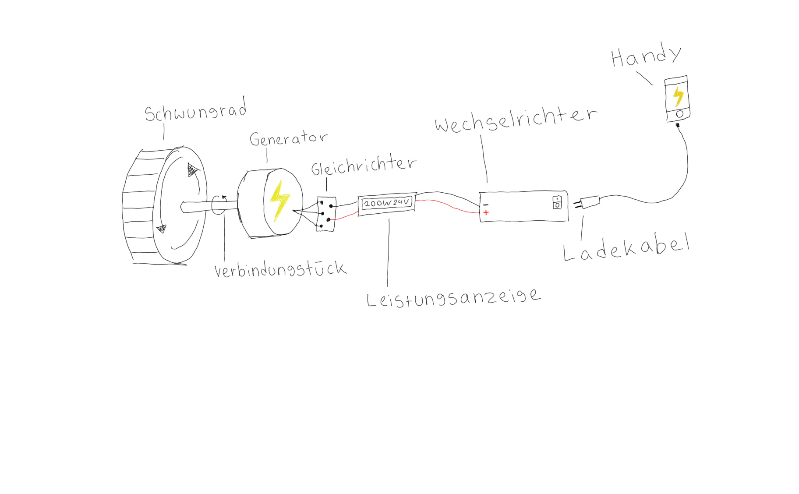
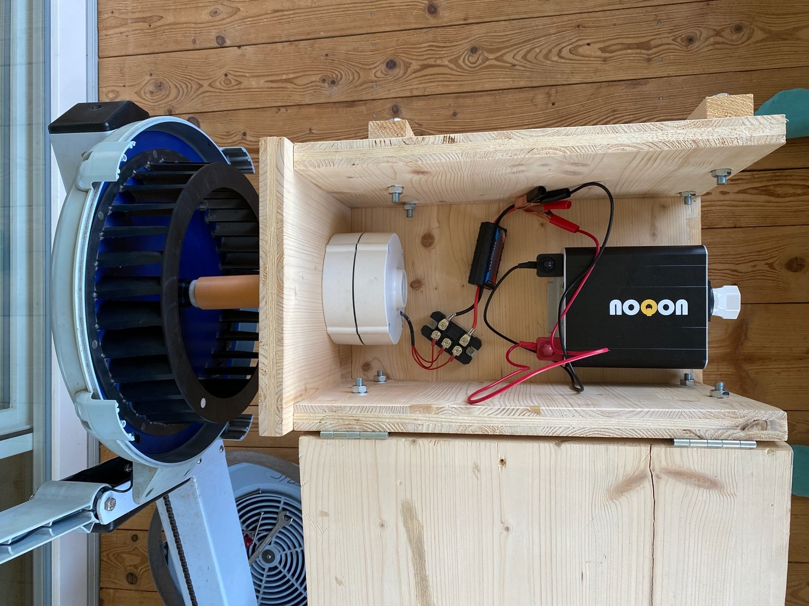
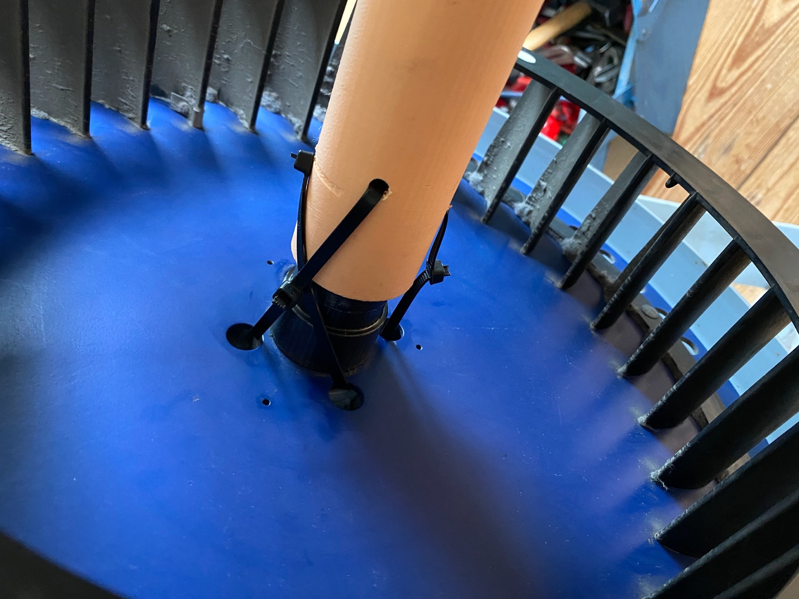

## Überblick

### Fragestellung

Die Arbeit entstand am Gymnasium Biel-Seeland (Matura 2024) und geht zwei Fragen nach:

1. Wie lässt sich ein Ruderergometer so umbauen, dass die im Training aufgewendete Energie in Strom umgewandelt wird?
2. Könnte das Ergometertraining im Seeclub Biel, dem Ruderclub, in dem ich trainiere, den Stromverbrauch des Clubs decken?

### Vorgehen

Ein Concept2-Ergometer (Modell D/E) treibt einen dreiphasigen Permanentmagnet-Generator aus einer kleinen Windkraftanlage an (Nennleistung 300 W bei 600 U/min). Der Generator ist mit einem 3D-gedruckten Verbindungsstück an das Schwungrad des Ergometers gekoppelt. Ein Dreiphasen-Gleichrichter wandelt seine Wechselspannung in 24 V Gleichspannung um, die über ein Leistungsmessgerät (V, A, W) in einen Wechselrichter von 24 V DC auf 230 V / 50 Hz AC geht. Alle Teile sitzen in einer selbst gebauten Holzbox, deren Höhe den Generator auf die Höhe der Schwungradachse bringt. Die Teile kosteten CHF 399, knapp unter dem Budget von CHF 400.

_Die Installation, wie sie in der Arbeit gezeichnet ist (Abb. 1)._

_Die fertige Installation mit geöffneter Box (Abb. 2)._

Fünf Testläufe zwischen Juli und September 2023 gingen jeweils das Problem an, das sich im vorherigen gezeigt hatte:

- **Test 1:** Mit einem Handyladegerät als Verbraucher schaltete der Wechselrichter immer wieder ab und piepste wegen zu tiefer oder zu hoher Spannung. Die Spannung stieg und fiel mit der Ruderintensität. Das Leistungsmessgerät zeigte meist 0 W, manchmal etwa 5 W.
- **Test 2:** Mit einem Wasserkocher als grösserem Verbraucher lief der Wechselrichter, und die Spannung war stabil, die Leistung blieb aber bei etwa 5 W.
- **Test 3:** Ein zweites Verbindungsstück mit einer Kerbe und einem Gegenstück aus Holz sollte verhindern, dass die Kupplung durchrutscht. Das Gegenstück hielt nicht, also wurde das Verbindungsstück mit Kabelbindern am Schwungrad festgezurrt, was funktionierte. Die Lötstellen blieben nach fünf Minuten Rudern kalt und schieden damit als Verlustquelle aus.
- **Test 4:** Die Spannung hielt sich bei etwa 14 V, die Leistung blieb aber bei 0 W, mit Spitzen von höchstens 3 W.
- **Test 5:** Nachdem die letzte Klemmverbindung durch Lötstellen ersetzt war, piepste der Wechselrichter wieder, und die Leistung erreichte Spitzen von 10 W.

_Das Verbindungsstück, mit Kabelbindern am Schwungrad befestigt (Abb. 17)._

### Ergebnisse

Im besten Fall lieferte die Installation etwa **5 W Dauerleistung**, weit unter den 300 W Nennleistung des Generators, und versorgte das angeschlossene Gerät nur zeitweise mit kleinen Strommengen. Ein Handy zu laden gelang nicht.

Für die zweite Frage geht die Arbeit von einer voll funktionsfähigen Installation mit 100 % Wirkungsgrad aus. Ausgehend davon, wie oft im Club im Renn- und im Breitensport auf den Ergometern trainiert wird, schätzt sie **413,4 kWh pro Jahr**, etwa 1/20 des Clubverbrauchs von 8461 kWh im Jahr 2022. Um ihn ganz zu decken, müssten alle acht Ergometer an jedem Tag des Jahres 14,5 Stunden lang gerudert werden. Bei etwa 32 Rp./kWh spart das CHF 132 pro Jahr, während acht Installationen CHF 3192 kosten würden, eine Amortisationszeit von etwa 24 Jahren. Die Leistung eines einzelnen Ergometers würde allerdings ungefähr reichen, um einen Kühlschrank, einen PC oder einen Fernseher zu betreiben.

### Fazit

Die Installation wurde wie geplant gebaut, lieferte aber nicht die erwartete Leistung, und für den Club würde sich die Investition nicht lohnen. Die Arbeit nennt mehrere wahrscheinliche Gründe: Komponenten, die möglicherweise nicht die richtige Wahl waren, ein Budget von CHF 400 und fehlendes Fachwissen, um den Problemen auf den Grund zu gehen. Für ein nächstes Mal hält sie fest: mehr Zeit für die Auswahl der Komponenten einplanen, früh einen Elektriker oder eine andere Fachperson beiziehen und ein klareres Ziel setzen (ein Handy laden, ins Netz einspeisen oder ein Gerät in Echtzeit betreiben).
